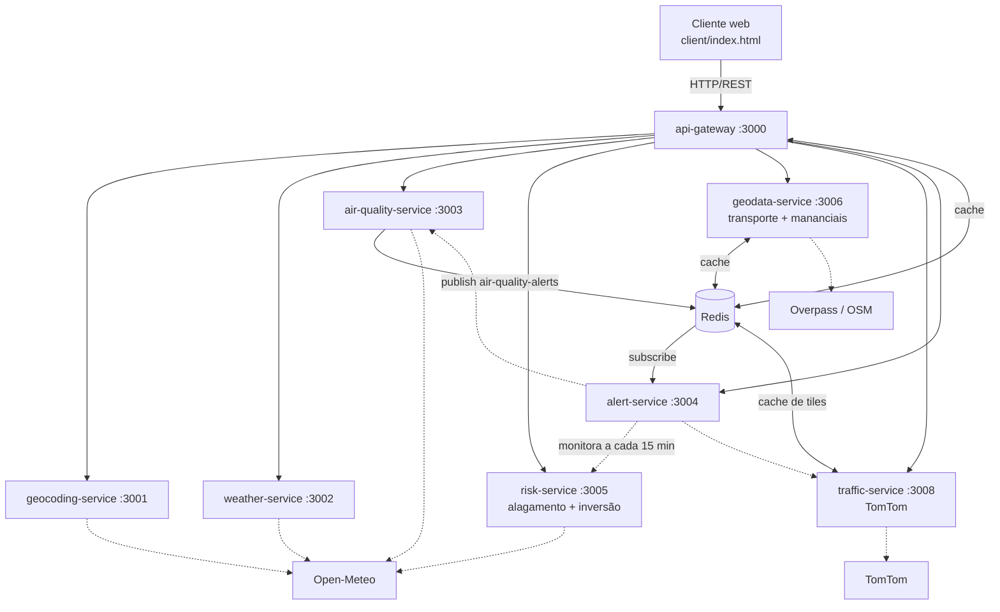

# Respira Urbana — Monitoramento Ambiental Urbano (Sistema Distribuído)

Aplicativo web/mobile que **mostra e monitora**, num único mapa:

| Tema | O que mostra | Fonte |
|---|---|---|
| 🌫️ Poluição do ar | Mapa de calor do IQA europeu, poluentes, UV, alerta de IQA ruim | Open-Meteo Air Quality |
| 🚦 Trânsito | Fluxo em tempo real, acidentes, obras e vias interditadas + lista de incidentes da área | TomTom Traffic |
| 🚌 Transporte público | Estações de metrô/trem/VLT, terminais e (em zoom alto) pontos de ônibus | OpenStreetMap (Overpass) |
| 🌊 Alagamento e inundação | Mapa de chuva prevista (24 h) classificada em níveis + vazão prevista dos rios | Open-Meteo Forecast + Flood (GloFAS) |
| 🌡️ Inversão térmica | Mapa e janelas de inversão nas próximas 24 h, com aviso de poluentes retidos (vento fraco) | Open-Meteo (perfil vertical) |
| 💧 Mananciais | Camada de **referência**: represas, lagos e áreas protegidas | OpenStreetMap (Overpass) |
| 🌳 Desmatamento | Camada de **referência**: perda de cobertura arbórea | Global Forest Watch (UMD/Hansen) |
| ☁️ Clima | Temperatura, chuva, vento, nuvens, pressão (camadas globais) | OpenWeatherMap + Open-Meteo |

Além do mapa: **alertas automáticos** (um serviço verifica periodicamente as cidades configuradas
e gera alertas de ar, alagamento, inversão térmica e trânsito) e um **painel das cidades monitoradas**.

> **Escopo:** somente leitura — monitoramento e alertas. Não há cadastro de ocorrências, banco de
> dados nem login de gestor. As camadas de mananciais e desmatamento são **referências** para
> contextualizar o mapa; **não detectam nem registram invasões** (isso exigiria imagens de satélite
> ou denúncias, e não é feito aqui).
>
> Os níveis de risco são estimativas de apoio baseadas em modelos de previsão e **não substituem
> os alertas oficiais** da Defesa Civil, INMET e CEMADEN.

## Arquitetura



Pontos principais:

- **Processos independentes** — cada serviço tem seu `package.json`, container e porta.
- **Comunicação síncrona (REST)** — o gateway chama os serviços em paralelo com
  `Promise.allSettled`: se um cair, o resto responde e o cliente mostra o status de cada parte.
- **Comunicação assíncrona (Pub/Sub no Redis)** — `air-quality-service` publica `air-quality-alerts`;
  `alert-service` consome sem que um conheça o outro.
- **Monitoramento ativo** — `alert-service` consulta sozinho `risk-service`, `air-quality-service`
  e `traffic-service` para os locais de `MONITOR_LOCATIONS` e guarda alertas (com deduplicação) e a
  situação de cada cidade no Redis.
- **Chaves protegidas** — a chave da TomTom **nunca** vai ao navegador: os tiles passam por
  gateway → `traffic-service` (com cache no Redis, que também economiza a cota gratuita).
  A chave da OpenWeatherMap vai ao navegador (os tiles são carregados direto de lá), por isso use
  a chave gratuita.
- **Cache** — Redis para respostas, grades do mapa, tiles de trânsito e consultas ao Overpass.

## Estrutura

```
respira-urbana-distributed/
├── docker-compose.yml
├── .env / .env.example          # chaves e configuração (o .env NÃO vai para o Git)
├── client/index.html            # app web (Leaflet), fala só com o gateway
├── mobile/                      # app Android (Capacitor)
├── scripts/check-apis.mjs       # testa de verdade cada API externa (veja abaixo)
├── tests/                       # npm test (Node 22, sem rede)
└── services/
    ├── api-gateway/             # :3000  porta de entrada, cache, proxy de tiles
    ├── geocoding-service/       # :3001  cidade → coordenadas
    ├── weather-service/         # :3002  clima e grade de chuva
    ├── air-quality-service/     # :3003  IQA, grade de poluição, publica alertas
    ├── alert-service/           # :3004  feed de alertas + monitoramento ativo
    ├── risk-service/            # :3005  alagamento (chuva + vazão) e inversão térmica
    ├── geodata-service/         # :3006  Overpass: transporte público e mananciais
    └── traffic-service/         # :3008  TomTom: tiles, incidentes, fluxo
```

## App Android

A pasta `mobile/` empacota este mesmo client como app Android (Capacitor), com tela para informar o endereço
do servidor. Passo a passo em [`mobile/README.md`](mobile/README.md). A versão web não muda.

## Rodando (Docker)

```bash
docker-compose up --build
```

- App: **http://localhost:8080** · Gateway: **http://localhost:3000**
- Cada serviço expõe `/health` na própria porta.
- Hot-reload: código em `services/*/src/` e `client/` é recarregado ao salvar (Node `--watch` +
  volumes). Mudou `package.json`, `Dockerfile` ou `docker-compose.yml`? Rode `up --build` de novo.
- Parar: `docker-compose down`.

> Se você já tinha uma versão anterior rodando, use `docker-compose up --build --remove-orphans`
> (remove os containers de Postgres e ocorrências, que não existem mais).

## Configuração (`.env`)

| Variável | Para quê |
|---|---|
| `OPENWEATHER_API_KEY` | Camadas de clima do mapa. Gratuita em openweathermap.org (chaves novas podem levar horas para ativar). |
| `TOMTOM_API_KEY` | Trânsito. Gratuita em developer.tomtom.com. **Vazia = tema Trânsito desativado** (o resto funciona). |
| `DEFORESTATION_TILES_URL` | Tiles XYZ do desmatamento. Vazia = padrão GFW/Hansen v1.8 (perda de cobertura arbórea até 2022). Para dados mais novos, troque a versão na URL. |
| `MONITOR_LOCATIONS` | Cidades vigiadas: `Nome:lat:lon;Nome:lat:lon`. Vazia = 6 capitais brasileiras. |
| `MONITOR_INTERVAL_SECONDS` | Intervalo entre verificações (padrão 900). |
| `AQI_ALERT_THRESHOLD` | IQA a partir do qual há alerta de ar (padrão 80). |

## Como usar o mapa

- Barra inferior, linha 1: **camada de clima** (uma por vez). Linha 2: **temas de monitoramento**
  (ligue quantos quiser; a escolha fica salva no navegador).
- A **legenda** (canto inferior esquerdo) mostra as cores de tudo que está ligado.
- **Pinos (focos)**: com poluição, alagamento, inversão ou trânsito ligados, o mapa marca os pontos críticos
  (células com IQA ≥ 60, chuva de risco alto, inversão moderada/forte, acidentes e interdições) e os locais com
  alerta ativo. Toque num pino para ver o detalhe. Em escala continental só aparecem os pinos de alertas.
- **Clique/toque no mapa**: pop-up com o valor da camada de clima e dos temas ligados naquele ponto
  (IQA, nível de alagamento, inversão, velocidade da via). O botão do pop-up seleciona o ponto.
- Abaixo do mapa: resumo do local (clima, ar, UV), **cartão de riscos** (alagamento com motivos,
  inversão com horário do pico, trânsito), **alertas**, **cidades monitoradas** (toque para abrir)
  e, com o tema Trânsito ligado e o mapa aproximado, **incidentes da área**.
- Alguns temas pedem **aproximar o mapa** (limites das APIs): trânsito/incidentes até ~0,8°,
  mananciais até ~1,5°, estações até ~2°, pontos de ônibus até ~0,2°. A legenda avisa quando falta zoom.

## Verificando as APIs de verdade (`check-apis`)

Os testes automáticos (`npm test`) usam respostas **simuladas**; só você, com internet e suas chaves,
consegue confirmar que as APIs reais respondem como o código espera. Rode:

```bash
node scripts/check-apis.mjs
# sem Node instalado:
docker run --rm -v "$PWD":/w -w /w node:22-alpine node scripts/check-apis.mjs
```

Ele testa Open-Meteo (clima, ar, vazão, perfil vertical, geocodificação), Overpass, tiles da
OpenWeatherMap, TomTom (tiles, incidentes, fluxo), Global Forest Watch e o seu gateway local.
Se algo falhar, a linha indica o HTTP e a dica (por exemplo, versão do GFW).

## Testes

```bash
npm test      # Node 22+; sem rede e sem npm install
```

Cobre: funções puras (grade, alagamento, inversão, TomTom, alertas), o backend inteiro de ponta a ponta
(gateway + todos os serviços + Redis em memória, com as APIs externas simuladas) e a lógica do cliente
(DOM/Leaflet simulados).

## Endpoints do gateway

`/api/config` · `/api/geocode?q=` · `/api/environment?lat=&lon=` · `/api/point?lat=&lon=&include=weather,air,flood,inversion,traffic` ·
`/api/grid/{air,rain,inversion}?south=&west=&north=&east=` · `/api/transit?…&scope=stations|all` · `/api/watersheds?…` ·
`/api/traffic/{status,incidents,flow}` · `/api/traffic/tiles/{flow|incidents}/{z}/{x}/{y}.png` · `/api/alerts` · `/api/monitor`

## Limitações conhecidas

- **Alagamento** é estimado por chuva prevista + vazão de rios (modelo global de 5 km); não conhece
  bueiros, relevo urbano nem pontos históricos de alagamento.
- **Inversão térmica** é inferida do perfil vertical previsto (modelo), não de radiossondagem.
- **Mananciais**: o OSM mostra represas, lagos e áreas protegidas, não o limite legal da área de proteção.
- **Desmatamento**: tiles globais do GFW (perda de cobertura arbórea, com defasagem de meses). Sem alertas
  em tempo quase real; o INPE/DETER cobre só Amazônia, Cerrado e Pantanal e não foi integrado.
- **Trânsito**: sujeito aos limites do plano gratuito da TomTom; a cobertura varia por país.
- Overpass é um serviço público compartilhado: o projeto limita área, faz cache e espaça as chamadas.

## Evoluções possíveis

Notificações push/e-mail no `alert-service`; DETER/INPE para a Amazônia; linhas (não só paradas) de transporte;
histórico de alertas em banco; múltiplas réplicas do gateway atrás de um load balancer; empacotar o cliente
como app móvel (Capacitor).
