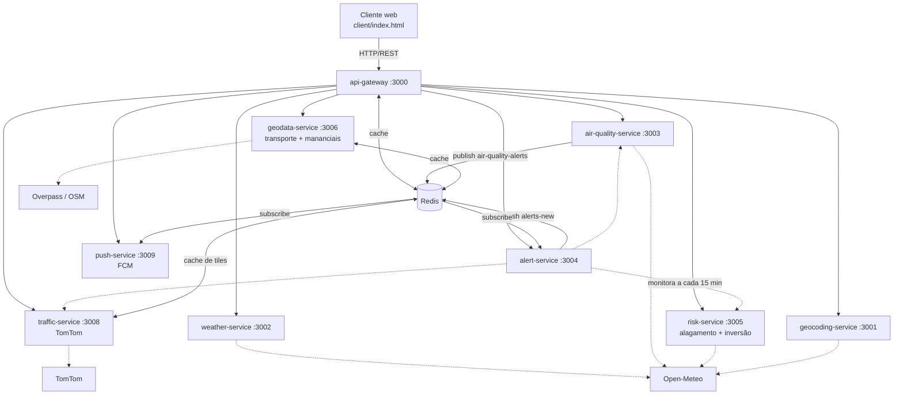

# Respira Urbana — Monitoramento Ambiental Urbano (Sistema Distribuído)

Aplicativo web/mobile que **mostra e monitora**, num único mapa:

| Tema | O que mostra | Fonte |
|---|---|---|
| 🌫️ Poluição do ar | Mapa de calor do IQA europeu, poluentes, UV, alerta de IQA ruim | Open-Meteo Air Quality |
| 🚦 Trânsito | Fluxo em tempo real, acidentes, obras e vias interditadas + lista de incidentes da área | TomTom Traffic |
| 🚌 Transporte público | Estações de metrô/trem/VLT, terminais e (em zoom alto) pontos de ônibus | OpenStreetMap (Overpass) |
| 🌊 Alagamento e inundação | Mapa de chuva prevista (24 h) classificada em níveis + vazão prevista dos rios | Open-Meteo Forecast + Flood (GloFAS) |
| 🌡️ Inversão térmica | Mapa e janelas de inversão nas próximas 24 h, com aviso de poluentes retidos (vento fraco) | Open-Meteo (perfil vertical) |
| 💧 Mananciais | Represas, lagos e áreas protegidas no mapa **e** a pergunta "este ponto está em área de manancial?" (dentro / perto / fora), no pop-up e no resumo do local | OpenStreetMap (Overpass) |
| 🌳 Desmatamento | Perda de cobertura arbórea (histórico) + **focos dos últimos 30 dias** como pinos, contagem por local e **alertas automáticos** (precisa da chave do GFW) | Global Forest Watch (UMD/Hansen + alertas integrados GLAD/RADD) |
| ☁️ Clima | Temperatura, chuva, vento, nuvens, pressão (camadas globais) | OpenWeatherMap + Open-Meteo |

Além do mapa: **alertas automáticos** (um serviço verifica periodicamente as cidades configuradas
e gera alertas de ar, alagamento, inversão térmica, trânsito, **calor, frio, vento, tempestade**, **transporte público**, **desmatamento** e **desmatamento em manancial**) e um **painel das cidades monitoradas**.

> **Escopo:** somente leitura — monitoramento e alertas. Não há cadastro de ocorrências, banco de
> dados nem login de gestor. O sistema **não confirma invasões**: ele cruza áreas de manancial/proteção
> (OpenStreetMap) com alertas de desmatamento por satélite (GFW) e avisa quando há sinais de
> supressão de vegetação dentro delas. Isso é um indício, que pede conferência em campo.
>
> Os níveis de risco são estimativas de apoio baseadas em modelos de previsão e **não substituem
> os alertas oficiais** da Defesa Civil, INMET e CEMADEN.

## Arquitetura



Pontos principais:

- **Processos independentes** — cada serviço tem seu `package.json`, container e porta.
- **Comunicação síncrona (REST)** — o gateway chama os serviços em paralelo com
  `Promise.allSettled`: se um cair, o resto responde e o cliente mostra o status de cada parte.
- **Comunicação assíncrona (Pub/Sub no Redis)** — `air-quality-service` publica `air-quality-alerts`;
  `alert-service` consome sem que um conheça o outro.
- **Monitoramento ativo** — `alert-service` consulta sozinho `risk-service`, `air-quality-service`, `weather-service`, `geodata-service`
  e `traffic-service` para os locais de `MONITOR_LOCATIONS` e guarda alertas (com deduplicação) e a
  situação de cada cidade no Redis.
- **Chaves protegidas** — a chave da TomTom **nunca** vai ao navegador: os tiles passam por
  gateway → `traffic-service` (com cache no Redis, que também economiza a cota gratuita).
  A chave da OpenWeatherMap vai ao navegador (os tiles são carregados direto de lá), por isso use
  a chave gratuita.
- **Cache** — Redis para respostas, grades do mapa, tiles de trânsito e consultas ao Overpass.

## Estrutura

```
respira-urbana-distributed/
├── docker-compose.yml
├── .env / .env.example          # chaves e configuração (o .env NÃO vai para o Git)
├── client/index.html            # app web (Leaflet), fala só com o gateway
├── mobile/                      # app Android (Capacitor)
├── deploy/                      # produção em VPS (compose + Caddy)
├── scripts/check-apis.mjs       # testa de verdade cada API externa (veja abaixo)
├── tests/                       # npm test (Node 22, sem rede)
└── services/
    ├── api-gateway/             # :3000  porta de entrada, cache, proxy de tiles
    ├── geocoding-service/       # :3001  cidade → coordenadas
    ├── weather-service/         # :3002  clima e grade de chuva
    ├── air-quality-service/     # :3003  IQA, grade de poluição, publica alertas
    ├── alert-service/           # :3004  feed de alertas + monitoramento ativo
    ├── risk-service/            # :3005  alagamento (chuva + vazão) e inversão térmica
    ├── geodata-service/         # :3006  Overpass: transporte público e mananciais
    ├── traffic-service/         # :3008  TomTom: tiles, incidentes, fluxo
    └── push-service/            # :3009  notificações push (Firebase Cloud Messaging)
```

## App Android

A pasta `mobile/` empacota este mesmo client como app Android (Capacitor), com tela para informar o endereço
do servidor. Passo a passo em [`mobile/README.md`](mobile/README.md). A versão web não muda.

## Notificações push e hospedagem

- **Push (FCM):** `push-service` + app Android. Configuração do Firebase em [`mobile/README.md`](mobile/README.md#notificações-push-firebase).
- **Servidor em nuvem (VPS):** `deploy/` traz o compose de produção com Caddy (HTTPS automático), `bootstrap.sh` e `update.sh`.
  Passo a passo em [`deploy/README.md`](deploy/README.md).

## Rodando (Docker)

```bash
docker-compose up --build
```

- App: **http://localhost:8080** · Gateway: **http://localhost:3000**
- Cada serviço expõe `/health` na própria porta.
- Hot-reload: código em `services/*/src/` e `client/` é recarregado ao salvar. Os serviços rodam sob
  `scripts/dev-runner.mjs`, que **verifica os arquivos por polling** (1 s, ajustável com `DEV_POLL_MS`) e reinicia o
  serviço; o `node --watch` não funcionava com pastas do Windows/macOS no Docker Desktop, porque o host não gera eventos
  de arquivo dentro do contêiner. Se o serviço quebrar (erro de sintaxe), o log avisa e ele volta ao salvar a correção.
  Mudou `package.json`, `Dockerfile` ou `docker-compose.yml`? Rode `up --build` de novo. Variável nova no `.env`
  também pede `docker-compose up -d` (recria o contêiner). O `client/` é só arquivo estático: basta recarregar a página.
- Parar: `docker-compose down`.

> Se você já tinha uma versão anterior rodando, use `docker-compose up --build --remove-orphans`
> (remove os containers de Postgres e ocorrências, que não existem mais).

## Configuração (`.env`)

| Variável | Para quê |
|---|---|
| `OPENWEATHER_API_KEY` | Camadas de clima do mapa. Gratuita em openweathermap.org (chaves novas podem levar horas para ativar). |
| `TOMTOM_API_KEY` | Trânsito. Gratuita em developer.tomtom.com. **Vazia = tema Trânsito desativado** (o resto funciona). |
| `DEFORESTATION_TILES_URL` | Tiles XYZ do desmatamento. Vazia = padrão GFW/Hansen v1.8 (perda de cobertura arbórea até 2022). Para dados mais novos, troque a versão na URL. |
| `GFW_API_KEY` | Alertas de desmatamento dos últimos 30 dias (pinos, contagem por local, alertas automáticos). Gratuita: rode `node scripts/gfw-key.mjs` (ver [Chave do GFW](#chave-do-gfw-alertas-de-desmatamento)). **Vazia = só a camada histórica**; o resto funciona. |
| `GFW_ORIGIN` | Domínio cadastrado na chave (padrão `http://localhost`). |
| `MANANCIAL_ALERT_MIN` / `FOREST_ALERT_MIN` | Alertas confirmados (30 dias) para avisar: dentro de mananciais (padrão 5) e num raio de 10 km (padrão 50). |
| `MONITOR_LOCATIONS` | Cidades vigiadas: `Nome:lat:lon;Nome:lat:lon`. Vazia = 6 capitais brasileiras. |
| `MONITOR_INTERVAL_SECONDS` | Intervalo entre verificações (padrão 900). |
| `FCM_SERVICE_ACCOUNT_B64` | Conta de serviço do Firebase (push). Gere com `node scripts/fcm-env.mjs chave.json`. Vazia = push desativado. |
| `AQI_ALERT_THRESHOLD` | IQA a partir do qual há alerta de ar (padrão 80). |

## Alertas e pinos por camada

Cada camada tem **alertas automáticos** (feed, painel e notificação push) e **pinos 🔥 no mapa** nos pontos críticos.
Os pinos aparecem quando a camada está ligada; os de clima, só quando a camada de clima correspondente está ativa.

| Camada | Quando alerta | Pinos no mapa |
|---|---|---|
| 🌫️ Poluição | IQA europeu ≥ 80 (`AQI_ALERT_THRESHOLD`); alta ≥ 100 | Células mais poluídas da área |
| 🌊 Alagamento | Risco alto / muito alto | Células com mais chuva prevista |
| 🌡️ Inversão térmica | Forte, ou moderada com vento fraco | Células com maior inversão |
| 🚦 Trânsito | ≥ 3 incidentes graves ou ≥ 2 vias interditadas | Acidentes, interdições e congestionamentos graves |
| 🚌 Transporte público | Estação/terminal a ≤ 400 m de via interditada, alagamento ou incidente grave (TomTom × OSM); alta se interdição ou ≥ 3 | Estações afetadas (alertas ativos) |
| 💧 Mananciais | ≥ 5 alertas de desmatamento confirmados dentro de um manancial (precisa da chave GFW) | Focos dentro de represas e áreas protegidas |
| 🌳 Desmatamento | ≥ 50 alertas confirmados em 10 km (precisa da chave GFW) | Focos dos últimos 30 dias |
| 🌡️ Temperatura | Calor: sensação ≥ 38 °C (alta ≥ 42). Frio: ≤ 3 °C (alta ≤ 0) | Alertas ativos de calor/frio |
| 💨 Vento | Rajadas ≥ 60 km/h (alta ≥ 90) | Alertas ativos de vento |
| ☔ Chuva | Tempestade com raios (código 95); com granizo (96/99) = alta | Alertas ativos de tempestade |
| ☁️ Nuvens, 🧭 Pressão | Sem alerta: não há limite que signifique risco por si só | — |

Os limites de clima são inspirados nas faixas de aviso do INMET e ficam em `WEATHER_LIMITS`
(`services/alert-service/src/alerts.js`). Os alertas de clima e de transporte são **de apoio**: não substituem os
avisos oficiais nem dados de operação das linhas. Ao tocar no mapa com o tema Transporte público ligado, o pop-up mostra a
estação mais próxima. Os alertas de clima valem para as cidades monitoradas (`MONITOR_LOCATIONS`).

## Chave do GFW (alertas de desmatamento)

A camada de desmatamento **histórico** não precisa de chave. Os **alertas recentes** (pinos 🌳, contagem no
pop-up e no resumo do local, alertas automáticos) usam a GFW Data API, que exige uma chave gratuita:

1. Crie uma conta em [globalforestwatch.org](https://www.globalforestwatch.org) pelo botão **Sign up**
   (não use o login com Google/Facebook, porque a chave exige senha) e confirme o e-mail.
2. Rode `node scripts/gfw-key.mjs`, informe e-mail e senha, e cole as duas linhas que ele imprime no `.env`
   (`GFW_API_KEY` e `GFW_ORIGIN`). Sem Node: `docker run --rm -it -v "$PWD":/w -w /w node:22-alpine node scripts/gfw-key.mjs`.
3. `docker-compose up -d --build geodata-service alert-service`.
4. Confira com `node scripts/check-apis.mjs` (a linha "GFW Data API" deve ficar OK).

A chave vale 1 ano. Em produção, cadastre o domínio do servidor no passo 2 e use o mesmo em `GFW_ORIGIN`.
Para limites maiores, escreva para gfw@wri.org.

**Como o sistema usa isso**

- *Ponto no mapa / resumo do local:* o OSM diz se o ponto está **dentro**, **perto** (< 500 m) ou **fora** de uma
  represa, lago ou área protegida (sem chave). O GFW conta os alertas num raio de 10 km.
- *Pinos 🌳:* com o tema Desmatamento ligado e o mapa aproximado, aparecem os focos dos últimos 30 dias
  (células de ~1 km). Alertas de confiança baixa (nuvem, sombra) são descartados.
- *Alertas automáticos:* para cada cidade monitorada, o serviço busca as áreas de manancial/proteção num
  raio de 15 km e conta os alertas **dentro delas** (represas: espelho d'água + ~1 km de margem). Passando do
  limite, gera "Desmatamento em área de manancial: …"; separadamente, "Desmatamento recente" para o raio de 10 km.
  Esses alertas também viram notificação push.

## Como usar o mapa

- Barra inferior, linha 1: **camada de clima** (uma por vez). Linha 2: **temas de monitoramento**
  (ligue quantos quiser; a escolha fica salva no navegador).
- A **legenda** (canto inferior esquerdo) mostra as cores de tudo que está ligado.
- **Pinos (focos)**: com poluição, alagamento, inversão ou trânsito ligados, o mapa marca os pontos críticos
  (células com IQA ≥ 60, chuva de risco alto, inversão moderada/forte, acidentes e interdições) e os locais com
  alerta ativo. Toque num pino para ver o detalhe. Em escala continental só aparecem os pinos de alertas.
- **Clique/toque no mapa**: pop-up com o valor da camada de clima e dos temas ligados naquele ponto
  (IQA, nível de alagamento, inversão, velocidade da via). O botão do pop-up seleciona o ponto.
- Abaixo do mapa: resumo do local (clima, ar, UV), **cartão de riscos** (alagamento com motivos,
  inversão com horário do pico, trânsito), **alertas**, **cidades monitoradas** (toque para abrir)
  e, com o tema Trânsito ligado e o mapa aproximado, **incidentes da área**.
- Alguns temas pedem **aproximar o mapa** (limites das APIs): trânsito/incidentes até ~0,8°,
  mananciais até ~1,5°, estações até ~2°, pontos de ônibus até ~0,2°. A legenda avisa quando falta zoom.

## Verificando as APIs de verdade (`check-apis`)

Os testes automáticos (`npm test`) usam respostas **simuladas**; só você, com internet e suas chaves,
consegue confirmar que as APIs reais respondem como o código espera. Rode:

```bash
node scripts/check-apis.mjs
# sem Node instalado:
docker run --rm -v "$PWD":/w -w /w node:22-alpine node scripts/check-apis.mjs
```

Ele testa Open-Meteo (clima, ar, vazão, perfil vertical, geocodificação), Overpass, tiles da
OpenWeatherMap, TomTom (tiles, incidentes, fluxo), Global Forest Watch e o seu gateway local.
Se algo falhar, a linha indica o HTTP e a dica (por exemplo, versão do GFW).

## Testes

```bash
npm test      # Node 22+; sem rede e sem npm install
```

Cobre: funções puras (grade, alagamento, inversão, TomTom, alertas), o backend inteiro de ponta a ponta
(gateway + todos os serviços + Redis em memória, com as APIs externas simuladas) e a lógica do cliente
(DOM/Leaflet simulados).

## Endpoints do gateway

`/api/config` · `/api/geocode?q=` · `/api/environment?lat=&lon=` · `/api/point?lat=&lon=&include=weather,air,flood,inversion,traffic,manancial,forest` ·
`/api/grid/{air,rain,inversion}?south=&west=&north=&east=` · `/api/transit?…&scope=stations|all` · `/api/watersheds?…` · `/api/manancial?lat=&lon=` · `/api/forest/alerts?lat=&lon=&radiusKm=&days=` (ou `south/west/north/east`) ·
`/api/traffic/{status,incidents,flow}` · `/api/traffic/tiles/{flow|incidents}/{z}/{x}/{y}.png` · `/api/alerts` · `/api/monitor` · `/api/push/{status,register,unregister}`

## Limitações conhecidas

- **Alagamento** é estimado por chuva prevista + vazão de rios (modelo global de 5 km); não conhece
  bueiros, relevo urbano nem pontos históricos de alagamento.
- **Inversão térmica** é inferida do perfil vertical previsto (modelo), não de radiossondagem.
- **Mananciais**: o OSM mostra represas, lagos e áreas protegidas, não o limite legal da área de proteção
  (faixas de proteção de nascentes e córregos, por exemplo, não estão no mapa). "Dentro/fora" vale para o que o OSM tem
  mapeado naquele local; fora das áreas mapeadas não significa fora de proteção legal.
- **Desmatamento**: os alertas integrados do GFW (GLAD/RADD) vêm de satélite com atraso de dias e podem ter falsos
  positivos; por isso só contam os de confiança nominal/alta e o texto sempre diz "indício". Sem a chave, só o histórico.
  O INPE/DETER cobre só Amazônia, Cerrado e Pantanal e não foi integrado.
- **Trânsito**: sujeito aos limites do plano gratuito da TomTom; a cobertura varia por país.
- **Transporte público**: não há dado em tempo real das linhas (atrasos, greves); o alerta é um indício de impacto
  por interdições e incidentes graves perto de estações, e depende da TomTom (sem chave, não há alerta).
- **Clima**: os alertas usam a condição *atual* das cidades monitoradas, não a previsão; vale 1 verificação a cada 15 min.
- Overpass é um serviço público compartilhado: o projeto limita área, faz cache e espaça as chamadas.

## Evoluções possíveis

E-mail/webhook no `alert-service`; DETER/INPE para a Amazônia; linhas (não só paradas) de transporte;
histórico de alertas em banco; múltiplas réplicas do gateway atrás de um load balancer; empacotar o cliente
como app móvel (Capacitor).
